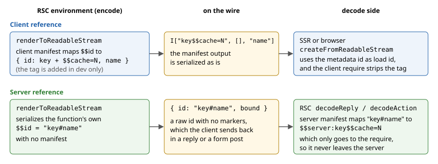
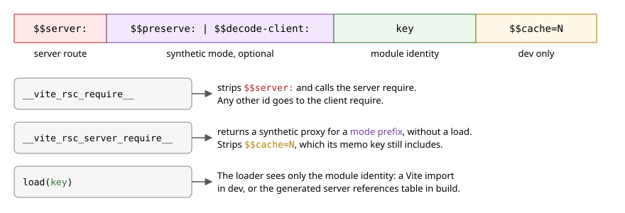

# Reference ids

This doc explains how plugin-rsc turns a client or server reference into a module load, and what the `$$` markers in those ids mean.

## Reference identity and load id

A reference has a **reference identity** of the form `key#name`. The `key` is the module identity: a 12-character hash of the module path in a build, or a Vite URL id such as `/src/action.tsx` in dev. The `name` is the export name. The plugin's `"use client"` and `"use server"` transforms register every reference under its `key` and `name`.

When React needs the module behind a reference, it asks a **manifest** to resolve the identity. The manifest returns an entry with a separate `name` and a **load id**. React passes the load id to `__webpack_require__`, which the plugin replaces with `__vite_rsc_require__`. Once the module resolves, React reads the export by `name`. The export name is never part of the load id.

A load id is the `key` with optional markers around it. The markers tell the require chain how to load the module.

## Which manifest handles which direction

React uses a manifest only where it needs one, and that differs between client and server references.

| reference               | encoded by                                                                            | decoded by                                                                                                                                              |
| ----------------------- | ------------------------------------------------------------------------------------- | ------------------------------------------------------------------------------------------------------------------------------------------------------- |
| client                  | `renderToReadableStream` in RSC, through the client manifest (`createClientManifest`) | `createFromReadableStream` in SSR or the browser, with no manifest. The serialized metadata id is used as the load id.                                  |
| client, replayed in RSC | as above                                                                              | `createFromReadableStream` in RSC, through `createServerDecodeClientManifest`                                                                           |
| server                  | `renderToReadableStream` in RSC, from the function's own `$$id`, with no manifest     | `decodeReply`, `decodeAction` and `decodeFormState` in RSC, and `createFromReadableStream` in RSC, through the server manifest (`createServerManifest`) |

A client reference needs a manifest when it is encoded, because the client has to know how to load the module. So the client manifest's output is what goes on the wire, and in dev the payload carries tagged ids such as `/src/client.tsx$$cache=…`.

A server reference needs no manifest when it is encoded, because the client only needs an id to call back with. React serializes the function's `$$id` as is. The server manifest is only used on the decode side, where it turns the id that the client sent back into a load id. Its output goes only to the require, so it never leaves the server.

## Markers

| marker             | added by                                                       | removed by                                              | purpose                                                                                                    |
| ------------------ | -------------------------------------------------------------- | ------------------------------------------------------- | ---------------------------------------------------------------------------------------------------------- |
| `$$server:`        | `createServerManifest` and `createServerDecodeClientManifest`  | `__vite_rsc_require__`                                  | routes the load id to the server require instead of the client require                                     |
| `$$decode-client:` | `createServerDecodeClientManifest`                             | the server require                                      | returns a synthetic client reference instead of loading the module, which RSC cannot load                  |
| `$$preserve:`      | `createServerManifest({ preserveServerReferences: true })`     | the server require                                      | returns a synthetic server reference that can be re-serialized but not called, so the module is not loaded |
| `$$cache=N`        | `createClientManifest` and `createServerManifest`, in dev only | the client or server require, before calling its loader | makes each render or decode miss the require memo, so an edited module is loaded again                     |

The markers exist because each environment has one global `__vite_rsc_require__`, and React calls it with nothing but the load id. Every mode must therefore be encoded in that string. RSC also decodes both server references and replayed client references through the same function, and SSR and RSC can share one global scope.

Each require memoizes its loads by the full load id, because React requires a module twice per reference and reads the state of the first promise the second time. The dev cache tag is part of that memo key, so a new render or decode gets a fresh load. The require strips the tag before it calls the loader, so the loader only ever sees the `key`.

## A raw reference id never carries a marker

A manifest receives a raw `key#name` and adds the markers to its output. A legitimate raw id never contains a marker, for these reasons:

- Markers are only ever added to a manifest's output.
- The client manifest's output is serialized, but only the client require reads it. A client reference never comes back to the server as a server reference id. When RSC replays a client reference, the server require removes the tag before it registers the synthetic reference, and the outer render adds a fresh tag.
- React serializes a server reference from its `$$id`, never from a manifest's output. Every `$$id` is registered with a raw `key`. This covers the transforms, the client stubs that `createServerReference` creates, and the synthetic `$$preserve:` reference, which is registered after both markers are removed.

So the raw ids that reach `createServerManifest` from a reply, a form post or a trusted RSC stream carry no markers. A raw id with a marker can only come from a forged request.

The rule has these limits:

- Export names can contain `$$`. Hoisted inline server functions are registered with names like `$$hoist_0_action`. The rule is about the `key` only.
- It holds because every place that registers a reference uses a raw `key`. Code that calls `registerServerReference` directly, for example through `@vitejs/plugin-rsc/react/rsc`, should do the same.

## Server action calls

The action id that a client sends with a hydrated server function call does not go through a manifest. `loadServerAction("key#name")` splits the id, loads the module through the loader, and reads the export. It does not use the require memo. Server references in the call's arguments, and the action of a progressive form post, are decoded through the server manifest as described above.
