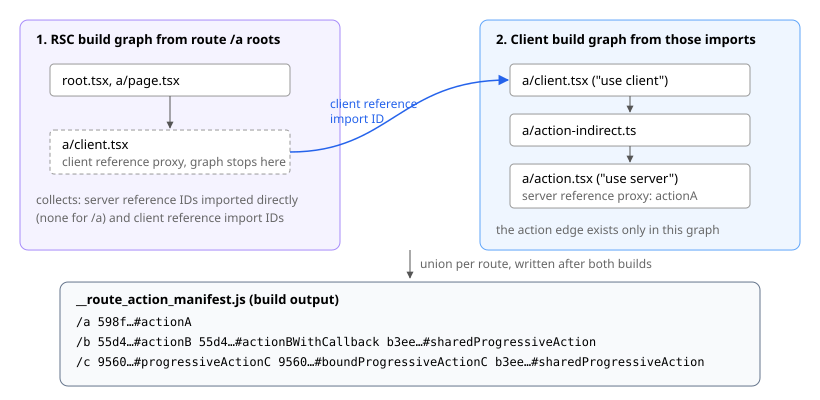
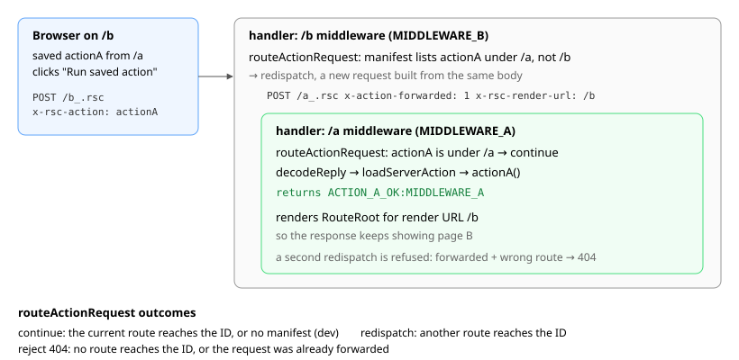
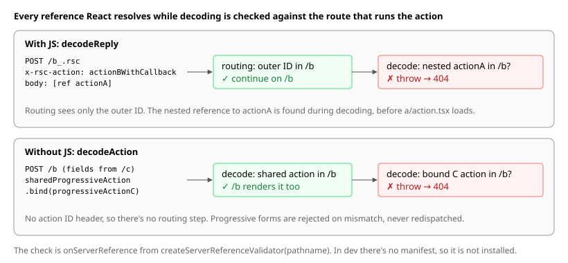

# Cross-Environment Action Reachability

This example demonstrates route-aware dispatch for a retained server action. Action A is associated with route `/a` because `/a`'s application graph reaches it, while `/b`'s graph does not. The browser can still retain its server reference, navigate to `/b`, and invoke it there.

See [#1337](https://github.com/vitejs/vite-plugin-react/issues/1337) for the broader discussion of route-aware server reference manifests.

The example follows this sequence:

1. Open `/a` and save action A in a shared browser module.
2. Navigate to `/b`, retaining the saved server reference.
3. Invoke action A through an explicit-ID action request to `/b`.

| Mode        | Action executes through | Result                     | Rendered page |
| ----------- | ----------------------- | -------------------------- | ------------- |
| Production  | `/a` middleware         | `ACTION_A_OK:MIDDLEWARE_A` | `/b`          |
| Development | `/b` middleware         | `ACTION_A_OK:MIDDLEWARE_B` | `/b`          |

In production, a generated route-action manifest tells the RSC handler which server references each route reaches. The handler uses it to redispatch an action request through middleware for a page whose graph reaches the action, and to reject server references that the route running the action cannot reach. The manifest is build-time data, so development stays on the current route and decodes every server reference.

## Manifest generation

For simplicity, the app routes and their graph roots are declared manually. Route `/a` reaches action A through a Client Component and an ordinary runtime return value:

```text
src/app/a/page.tsx
  -> client.tsx ("use client")
  -> action-indirect.ts returns actionA
  -> action.tsx ("use server")
```

The final RSC graph ends at the Client Component proxy, so the edge to action A exists only in the final client graph. During the RSC build, the manifest plugin traverses each route graph and records directly reachable server reference IDs and reachable Client Component import IDs. During the client build, it traverses the client graph from those import IDs and records reachable server reference IDs. For each route, it unions the two sets, and after all environment builds finish, it writes the mapping into the RSC output for runtime use.



Each entry has the same `<id>#<name>` form that the RSC runtime uses for server references, so the runtime checks compare strings directly.

## Request redispatch

A hydrated action call carries its action ID in a request header, so the handler can choose a route before decoding the body. For the production scenario above, the handler finds action A under `/a` in the manifest and creates a new action request for `/a`. That request re-enters `/a` middleware inside the original `/b` request, so the action observes `MIDDLEWARE_A`. It also preserves `/b` as the render URL, so the response continues rendering page B.



Development skips route-aware redispatch. The handler executes action A on `/b`, so the action observes `MIDDLEWARE_B`.

## Nested server references and progressive forms

Routing sees only the outer action ID, but server functions can also arrive nested inside a request, as an argument to the action or bound to it. React finds these only while `decodeReply()` or `decodeAction()` decodes the body, so the handler passes an `onServerReference` callback that checks every server reference against the route running the action. The callback throws before an unreachable reference's module loads, and the handler responds with 404.

Progressive forms have no action ID header and normally post back to the route that rendered them. A mismatched progressive action is therefore rejected as stale or manipulated input rather than redispatched, and this decode-time check is the only one it passes through. Next.js similarly validates progressive form fields against the current page's server module map, using a [pre-decode parser](https://github.com/vercel/next.js/blob/aae4179ac628e55483b62cd023a7e1827dcef122/packages/next/src/server/app-render/action-handler.ts#L1467-L1576) of React's multipart fields.



The example covers both cases:

- On `/b`, passing a retained action A as an argument to an action on `/b` is rejected even though the outer action is reachable from `/b`. Passing a retained action B succeeds. Next.js also routes this request by the outer action ID only, and decoding then fails to find action A ([vercel/next.js#96331](https://github.com/vercel/next.js/issues/96331)).
- Route `/c` renders unbound and bound progressive forms, and a shared action that `/b` also renders, bound to an action only `/c` reaches. Their normal submissions run through `/c` middleware, while replaying the same multipart fields to `/b` is rejected.
